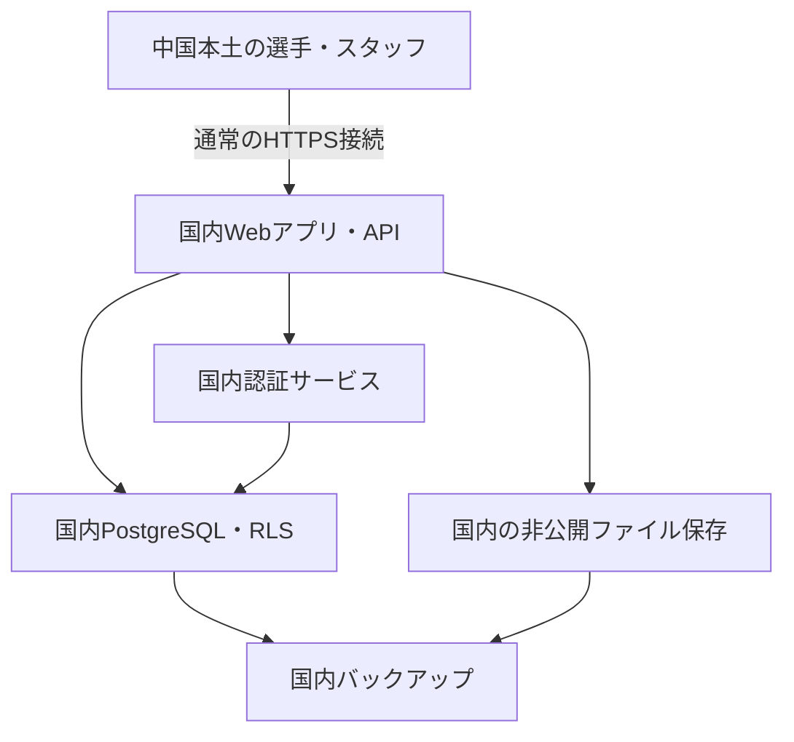

# 中国本土・VPNなし運用の構成案

更新日：2026-11-07。構成検討の記録です。国内サーバーへの配備、契約、データ移行、中国本土回線での動作確認はまだ行っていません。

## 前提と推奨方針

- 中国本土のスタッフ・選手がVPNなしで、本人入力、代理入力、閲覧、CSV／Excelの出力・取り込みを利用できることを本番の受入条件にします。
- ユーザーから、中国国内のサーバー・クラウド契約・独自ドメインは「まだない」と確認済みです。
- 従来の「すべて無料」という希望も維持して検討します。ただし、新規の国内サーバー、ドメイン、保管容量、通信、メール等の継続費用を含めて恒久無料になる構成は確認できていません。
- 第一候補は、中国本土リージョンのクラウドにWebアプリ・DB・認証・ファイルを集約する構成です。阿里云または腾讯云など、チームが契約・運用できる事業者の条件を確認して選定します。香港やシンガポールへの配置を、中国本土内での配置と同じ接続条件として扱いません。
- 現行のSupabase Cloud＋Netlifyは既存公開構成です。中国本土でのVPNなし運用に合格した本番構成とは扱いません。Cloudflare／D1／Dropboxへの共通化案も、本要件の第一候補から見直します。

## 共通の保存先

| 扱うもの | 国内構成の候補 | 方針 |
| --- | --- | --- |
| Web画面・アプリAPI | 国内クラウドのサーバー | 利用者はHTTPSのアプリURLから操作 |
| Wellness・RPE・練習・集計元データ | 国内サーバー上のPostgreSQL | 現在のRLSと、選手・チーム・セッションの対応を維持 |
| 個人ログイン・セッション | 同じ国内基盤に設置するSupabase Auth等 | 現行機能を生かすためSupabaseのセルフホストを第一候補にする |
| GPS原本・CSV／Excel原本・PDF・画像 | 同じ国内クラウドの非公開ファイル領域 | 初期は国内ディスクも候補。容量・運用に応じてOSS／COS等を比較 |
| DB・ファイルのバックアップ | 国内の別の障害領域 | 同じディスクへのコピーだけにせず、復元確認も行う |

Supabaseのソフトウェアを国内サーバーで動かす案であり、海外のSupabase Cloudへ保存し続ける案ではありません。セルフホストは公式に案内されていますが、運用・更新・障害対応・バックアップは自分たちで担当します。ソフトウェアの利用と、サーバー等の運用費は分けて見積もります。

OSS／COS等へのファイル接続は未実装です。Supabase Storageの接続互換性、署名URL、CORS、権限を実際に検証するか、アプリのファイルAPIから事業者のSDKで扱う方式を選びます。現行の出力CSV／Excelは端末へダウンロードする機能で、原本をサーバーへ自動保存する機能とは分けて実装します。

## 他システムとの統一

共通化するのはクラウド契約だけでなく、組織・利用者・選手・セッションID、ファイルの所有者情報、バックアップ先です。各機能のテーブルまたはスキーマを分け、アプリごとの権限を確認します。共通ログインにしても、医療情報や担当外チームへのアクセスは許可しません。

この作業環境でコードを確認できるのはMonitoringのみです。他の3システムの構成・既存データは未確認なので、全システムの移行方法や必要容量は、各リポジトリを確認してから確定します。論文翻訳・AI処理・GPS地図などに外部サービスがある場合は、それらも中国本土からの通信条件、費用、代替経路を調べます。保存先を国内化しただけで全機能がVPNなしになるとは判定しません。

## 現在のコードで確認した事項

- Next.jsの画面、データ取得API、RLSポリシー、Supabase Authによる個人ログインを使用しています。
- ログイン、登録、再設定、招待受諾等で、ブラウザーから設定済みSupabaseのURLへ直接接続します。移行後はこれらのURL・通信先も国内のものにします。
- ソース上のフォントは端末のシステムフォントです。外部フォントや外部CDNの読み込みは見当たりませんでした。最終的にはブラウザーの通信記録でも確認します。
- レポートのXML名前空間にあるURLは、外部への通信ではありません。
- 7言語、セッション別の本人入力・代理入力、CSV／Excel往復、赤・黄・欠測の表示は既存機能として移行後も検証します。

## 契約前に確認する項目

1. チーム側で利用できる契約名義、実名確認、国内クラウドの利用条件、独自ドメインとICP备案の対応条件を確認します。中国本土サーバーでの公開では、事業者の案内に従って必要な手続きを確認します。
2. サーバー、ディスク、通信量、バックアップ、ファイル保管、ドメイン更新、SMTPの継続費用を見積もります。初年度割引・無料試用を恒久無料とは扱いません。
3. Supabase公式資料では、全コンポーネントの最小要件は2コア・RAM 4GB・SSD 40GB、推奨は4コア以上・RAM 8GB以上・SSD 80GB以上です。これはSupabase部分の目安であり、Next.jsや他システムを含む必要容量・性能の保証ではありません。不要なサービスを省く場合も構成と負荷を検証します。
4. 国内で届く確認メール・再設定メールの送信方法を決めます。SMSや外部ログインを無料で使える前提にはしません。
5. 新しい有料契約・購入は、構成と継続費用を提示し、ユーザーの承認を得てから行います。パスワードや管理用キーはチャットやGitへ保存しません。

## 移行の順序

1. 国内事業者・費用・契約と公開手続きの条件を確認します。
2. 架空データで国内Web・DB・Authを構築します。HTTPS、公開URL、認証コールバック、メールを設定します。
3. 国内ファイル保存・権限付き取得・バックアップと復元を実装・確認します。管理コンソールやDBポートを選手向け公開窓口にはしません。
4. 既存データとAuthユーザーの有無を確認し、IDの対応、認証移行、必要な再招待を計画します。既存DBへの初回SQLの再実行や、未検証の上書き移行は行いません。
5. RLS、各役割の操作、複数セッション、CSV／Excel取り込み、言語切り替えを国内構成で再検証します。
6. 現地の通常回線で受入試験を行い、切替・復旧手順を用意してから実運用へ移します。他システムも共通IDと権限を確認しながら段階的に移します。

GitHub・Docker Hub等を日々の利用や毎回の起動に必要な通信先にせず、必要なビルド成果物・イメージを国内に配備します。導入・更新時の取得経路も確認し、配布元や署名・ダイジェスト、TLSの検証を省略しません。

## 中国本土・VPNなしでの受入試験

中国本土のチーム回線とスマートフォン回線で、VPNを使わずに以下を確認します。可能な範囲で中国移動・中国聯通・中国電信の異なる回線を試し、端末・回線・実施日・結果を記録します。

| 操作 | 確認する結果 |
| --- | --- |
| 初期表示・7言語切り替え | 画面と必要な静的ファイルが読み込める |
| 登録・ログイン・招待・再設定 | メールが届き、認証と画面復帰が完了する |
| 選手のWellness入力と3回以上の練習別RPE | 記録を保存・再取得でき、別セッションへ混在しない |
| コーチの閲覧・代理入力 | 担当チームを更新でき、他チームや医療メモの制限が保たれる |
| CSV／Excelの出力・記入・再取り込み | 対象練習へ保存され、空欄・既存記録の扱いが維持される |
| 原本ファイルのアップロード・取得 | 権限付きで完了し、別利用者から取得できない |
| 再読み込み・別端末・バックアップ復元 | 記録を失わず、復元後もIDと権限が対応する |

この開発環境からの接続や、ログイン画面が表示されることだけでは、上記の現地試験に合格したとは扱いません。現在は未実施です。

## 確認した資料

- [Supabase公式：Dockerでのセルフホスト](https://supabase.com/docs/guides/self-hosting/docker)
- [同公式資料の公開ソース](https://github.com/supabase/supabase/blob/master/apps/docs/content/guides/self-hosting/docker.mdx)
- [公式Docker構成](https://github.com/supabase/supabase/tree/master/docker)

セルフホストの機能・要件は公式公開ソースを確認しました。国内クラウドの最新料金、契約資格、ドメイン・备案の個別条件はまだ確認できていないため、確定費用や利用資格は提示していません。
